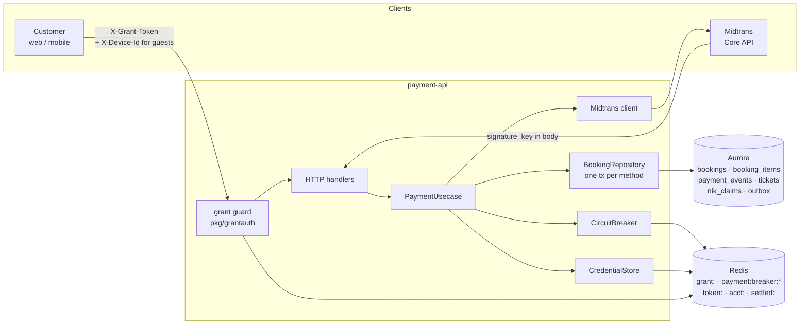

# 07 — Payment

The only component that talks to Midtrans. It owns the five endpoints of
api-contracts §5 and the webhook that turns a settlement into tickets.

**Service**: `services/payment-api` (Lambda + API Gateway HTTP API)

**Sources**: ADR-005 §9, §12, §17 · ADR-006 §3.2, §4.1, §8.9, §8.13 ·
api-contracts §5, §6.3 · impl-plan §10 · requirements FR-20…FR-26, FR-28,
FR-28a · BR-02, BR-05, BR-07 · NFR-02, NFR-07.

## Files

| # | File | Apidog request |
|---|---|---|
| 01 | [01-get-payment-methods.md](01-get-payment-methods.md) | `GET /payments/{booking_id}/methods` |
| 02 | [02-initiate-payment.md](02-initiate-payment.md) | `POST /payments/{booking_id}` |
| 03 | [03-cancel-switch-method.md](03-cancel-switch-method.md) | `POST /payments/{booking_id}/retry` |
| 04 | [04-get-payment-status.md](04-get-payment-status.md) | `GET /payments/{booking_id}/status` |
| 05 | [05-payment-webhook.md](05-payment-webhook.md) | `POST /payments/webhook` |
| 06 | [06-grant-guard.md](06-grant-guard.md) | — internal component (`pkg/grantauth`) |

## 1. Component overview



## 2. Credential model

ADR-005 §17 gives four credentials four slots, and they are not
interchangeable. Two of them reach these endpoints:

| Credential | Slot | Sent here? |
|---|---|---|
| Grant | `X-Grant-Token` | **Always** — this is the credential that authorises |
| Account session | `Authorization: Bearer` | **Only when the grant names an account**, and then required (§8.17) |
| Waiting-room token | `queue_token` cookie / `X-Queue-Token` | No |
| E-ticket token | `?t=` | No |

The grant is what authorises: it says the bearer holds seats, which is the only
question these endpoints ask. `Authorization` answers a different one — *who*
the bearer is — and on its own it would let a logged-in customer with no grant
pay for a booking, which must not happen.

So why is it required at all? Because a grant that names an account is a
bearer token for someone's identity as well as their seats. ADR-006 §8.17
closed that: when `grant:{token}` carries `account_id`, the guard also
verifies the session in `Authorization` and that its subject is that same
account. A grant copied out of someone's browser is then worth nothing without
their session, and the purchase stays attributed to the account the grant
names — read from the hash, never from the header, so a stale header cannot
attribute a booking to the wrong account. A **guest** grant carries
`device_hash` instead and no `Authorization` is read: there is no account to
check, and the device binding (§8.9) is what holds.

A valid grant proves the bearer holds **a** slot — not that the slot belongs to
the `booking_id` in the URL. Every query therefore binds both
(`WHERE id = $1 AND grant_token = $2`). The credential half is
[06-grant-guard.md](06-grant-guard.md); the ownership half is the repository's,
and no match answers **404, never 403** (ADR-005 §12).

## 3. What this service does NOT touch

Nothing here reads or writes a queue counter.

- `slots:open:{ev}` is **deleted** (ADR-006 §3.2).
- The webhook's old inline `DECR slots:open` + `EVALSHA advance_now_serving.lua`
  + `PUBLISH sse-grant` block is removed **with no replacement** (ADR-006 §4.1,
  "tanpa pengganti"). `advance_now_serving.lua` now has exactly one caller,
  `admission-ctl`, which recounts open slots from Aurora every tick and picks a
  freed seat up within 500 ms.
- The lease that ADR-005 specified around the post-commit block is gone with it:
  it existed to protect one non-idempotent operation, the `DECR`, and that
  operation no longer exists. What remains — credential cleanup — is idempotent.

**impl-plan §10.5 still describes the old block.** Where the two disagree,
ADR-006 wins; the plan is the document to fix.

## 4. Transaction boundaries

Each repository method is exactly one transaction, and the use case never sees
a `pgx.Tx`: a port that hands one out makes every caller a database client and
makes "who commits this" unanswerable.

| Endpoint | Transaction | Gateway call inside it? |
|---|---|---|
| §5.1 methods | one read, no tx | no |
| §5.2 initiate | lock → replay/charge → write → commit | **yes**, under the row lock |
| §5.3 retry | lock → validate → cancel → write → commit | **yes**, before the commit |
| §5.4 status | one read, no tx | no |
| §5.5 webhook | idempotency insert → lock → transition → outbox → commit | **no** |

The two that do call the gateway hold the `bookings` row across the call, on
purpose. Two concurrent "Pay" clicks have to serialise somewhere and the row is
the only thing both of them touch; and a cancel that happens after the commit
would leave a customer with a raised attempt counter **and** a still-payable
virtual account.

## 5. Key design decisions

- **Core API, not Snap.** Snap hosts its own payment page, which would take the
  countdown out of our hands and put a redirect in the middle of the flow. Core
  API returns the VA number or QR to us, so the customer never leaves the app
  and the deadline stays ours (ADR-005 §9).
- **`order_id = {booking_id}:{payment_attempts}`, derived server-side.** Core
  API carries idempotency on `order_id` itself and refuses one it has seen, so a
  bare `booking_id` would be rejected on the second attempt and lock the
  customer out of paying for their own booking. The attempt number is what makes
  a *new* charge possible after a decline.
- **`custom_expiry` on every charge, anchored on `held_at`.** Without it a VA
  defaults to 24 hours at the gateway and stays payable after the seats are
  resold. Anchored on the request time instead, every method switch would grant
  a fresh ten minutes and BR-05 would never bind.
- **Two methods only.** `bank_transfer` (BCA/BNI/BRI/CIMB) and `gopay`. Cards
  and over-the-counter are excluded because neither honours `custom_expiry`;
  that choice also removes the reversal class, which Midtrans documents only for
  Permata, Mandiri Bill Payment and Indomaret (§5.1).
- **A timeout is never a failed charge.** Midtrans is a *write* dependency: the
  instrument may well exist. The answer is 503, the breaker counts a failure,
  `payment_ref` stays NULL, and the charge reconciler in `admission-ctl`
  establishes the truth later (ADR-005 §8, §9).
- **The webhook always answers 200.** See
  [05-payment-webhook.md](05-payment-webhook.md) §6.
- **The breaker gates new charges only.** A replay of §5.2 answers from stored
  state and needs no gateway call, so it keeps working while the breaker is
  open; a double-clicked Pay button must not turn a working payment into a 503.

## 6. Shared state

| Store | Key / table | Written by | Notes |
|---|---|---|---|
| Redis | `grant:{token}` | booking-service | Read-only here. Fields fixed by ADR-006 §8.13(a) |
| Redis | `payment:breaker:state`, `payment:breaker:failures` | this service | Distinct from `dukcapil:breaker:state`: one upstream being down says nothing about the other |
| Redis | `token:{uuid}`, `acct:{ev}:{account_id}` | queue-service | Deleted here on settlement |
| Redis | `settled:{uuid}` | this service | The §3.3 tombstone. Holds the booking id and nothing else |
| Aurora | `bookings`, `booking_items`, `payment_events`, `tickets`, `nik_claims`, `outbox` | this service | Migrations `0006`–`0010` (booking domain), `0011` (`payment_events`), `0013` (`bookings.paid_at`) |
| Aurora | `payment_method_switches` | operators, by hand | Read-only here, append-only by design. Migration `0014` |

## 7. Schema

Almost everything this service reads was already added by the booking domain's
migrations. Only one table is this service's own:

| Object | Migration | Why payment-api needs it |
|---|---|---|
| `payment_events` with `gateway_event_id UNIQUE` | `0011_payment_events` | The webhook's idempotency guard, and where a charge response is stored for replay |
| `bookings.paid_at` | `0013_bookings_paid_at` | The gateway's settlement time, which §5.4 reports. Before it, `paid_at` was substituted with the payment DEADLINE — a timestamp in the future of the response carrying it |
| `payment_method_switches` | `0014_payment_method_switches` | The operator kill switch: turn a method, or one bank under it, off mid-sale with no deploy. Append-only; subtracts from the code catalogue and never defines it |
| `bookings.grant_token` + partial unique index | `0006`–`0010` | The ownership key every query binds on |
| `booking_items` | `0006`–`0010` | One row per NIK (BR-02). The authority on price, and what tickets are issued from |
| `nik_claims` | `0006`–`0010` | Released on expiry, or BR-02 would block the customer from ever buying again |
| `tickets.booking_item_id` + partial unique index | `0006`–`0010` | The double-QR guard: an index on `booking_id` alone would not collide across two attempts for one booking |
| Partial index on `bookings (payment_expires_at)` | `0011_payment_events` | ADR-006 §8.12(c) moved the deadline sweep off `expiries:{ev}` and onto this index, so nothing in Redis has to be kept in step with a booking's deadline. `0007` and `0009` did the same for the `GRANTED` and `SELECTING` deadlines |

`booking_items` deliberately carries **no** per-seat email: migration `0010`
dropped `holder_email`, and §8.15 sends every e-ticket of a booking to
`bookings.contact_email`.

The pipeline deliberately does **not** run migrations (see the note in
`.github/workflows/cicd.yml`): the schema is applied by hand, and a service
deploy reports success whether or not the schema matches.

## 8. Deploy

Two templates, like every other service here:

| File | Role |
|---|---|
| `template-cfn.yaml` | Raw CloudFormation. **This is what the pipeline deploys**, through `.github/actions/cfn-deploy` |
| `template.yaml` | The SAM description of the same stack. Reference, and `sam local`; not deployed |

An SCP in this account denies `cloudformation:CreateChangeSet` on the
`Serverless-2016-10-31` transform, so a SAM template cannot be deployed at all
— the error names the transform, not the template, which is why it reads like a
role problem. A change to one template belongs in both.

`EnableDirectApiAccess` decides whether this service gets a per-service API
Gateway endpoint of its own. It is `false` in the pipeline: the unified gateway
(`infra/api-gateway/template.yaml`) is the single entry point and carries all
five routes, the webhook included. **Midtrans calls the webhook from the
internet**, so one public route must exist — with direct access off, the URL for
the dashboard is the unified gateway's (`/rusuh/{env}/api/url`) plus
`/payments/webhook`.

## 9. Turning a payment method off mid-sale

`entity.Catalogue()` is what the code can charge. `payment_method_switches`
(migration `0014`) is what an operator has turned off since. §5.1 masks the
first with the second, and §5.2 refuses a charge for anything switched off —
both, because a customer who loaded the page before the switch still has the
button on screen.

Turning something off, and on again, are both **inserts**:

```sql
-- off
INSERT INTO payment_method_switches (method_id, bank_code, available, reason, changed_by)
VALUES ('bank_transfer', 'bca', false, 'BCA VA timeouts, confirmed with ops', 'hdwic');

-- on
INSERT INTO payment_method_switches (method_id, bank_code, available, reason, changed_by)
VALUES ('bank_transfer', 'bca', true, 'BCA recovered 21:28', 'hdwic');
```

`bank_code NULL` disables the whole method. `expires_at` makes a switch revert
itself, which is worth using: the failure mode is not forgetting to switch BCA
off, it is switching it off during an incident and nobody remembering to switch
it back, so a bank stays dark for a week and the first sign is a conversion
graph.

The read is the latest row per method and bank, which is why turning something
back on is an insert rather than a `DELETE`: the incident timeline survives.
`RUNBOOK.md` has the operator procedure, and
[01-get-payment-methods.md](01-get-payment-methods.md) §6 has the design.

## 10. Open decisions

| # | Decision |
|---|---|
| 1 | **OPEN:** api-contracts §5.5's event table says a late settlement emits `payment.refund`. No such outbox type exists, and §6.3 states the customer receives a **`payment.failed_notice`** saying the money arrived, the booking was cancelled and a refund is being processed. The implementation follows §6.3 (`events.FailureDisputed`). The §5.5 table cell needs correcting. |
| 2 | **OPEN:** `MIDTRANS_SERVER_KEY` is created by the foundation stack holding `REPLACE_ME`. With that value the service starts, accepts requests and rejects every callback — money taken, no ticket issued. Populate it, and set the Midtrans dashboard's Payment Notification URL — the unified gateway's URL plus `/payments/webhook`, or this stack's `WebhookUrl` output when direct access is on — before the first charge. Neither is checked by CI; preflight only warns. |
| 3 | **OPEN:** `DEVICE_PEPPER` must be the same value in whatever issues grants (booking-service) and here. Nothing enforces that today; a mismatch shows up as `401 DEVICE_MISMATCH` on every guest checkout and nowhere else. |
| 4 | **OPEN:** `MAX_PAYMENT_ATTEMPTS` (5) and `MIN_RETRY_REMAINING_SECONDS` (60) are product policy with no stated source. Confirm with the team before the sale. |
| 5 | **OPEN:** The API Gateway resource policy that allowlists Midtrans's notification IPs (§5.5) is in neither template, and the webhook now arrives through the unified gateway, so the policy would belong on `infra/api-gateway/template.yaml` and would apply to every route on that API. Today the signature is the only authentication on the webhook — which is the authentication that matters, but the allowlist was specified and is missing. |
| 6 | **OPEN:** `/admin/reconciliation/disputed` (§6.3, Apidog › Admin) is assigned to this service in `docs/README.md` but not implemented. It is the operator's half of the late-settlement path; without it a disputed payment is only discoverable in CloudWatch. Plan it as `08-admin/`. |
