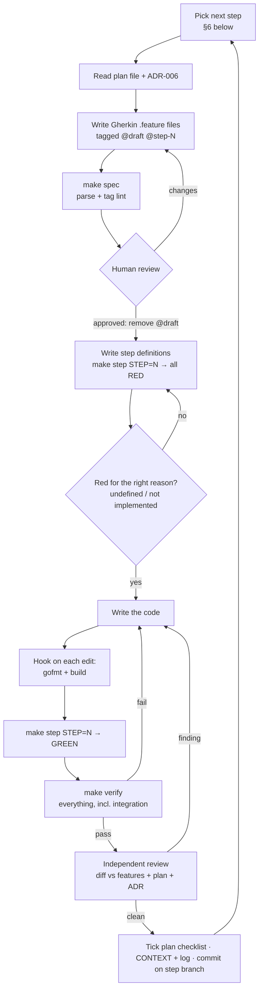

# Development Flow — spec first, self-validating

How every build step is done, by a person or by Claude Code. The short version:
**a feature file says what "done" means, a human approves it, and a script (not the
author) decides whether the code meets it.**

Analogy: the `.feature` file is the order ticket, `make verify` is the taste test, the
Stop hook is the kitchen door that stays shut while the dish fails, and the reviewer is the
inspector who didn't cook it.

## 1. The loop for each build step

**Gate rule:** no implementation code for a feature that still carries `@draft`.
`make step STEP=N` enforces it (exit 2 while any `@step-N` feature is `@draft`).

## 2. Where the specs live

Feature files sit next to the code that makes them pass, so `go test` in that package runs them
(godog, `Strict: true`, so an undefined or pending step fails). Each package with a `features/`
folder needs a `TestFeatures` suite next to it; `make step` refuses otherwise, because `go test`
would pass with zero scenarios run (a false green).

| Package | Features |
|---|---|
| `pkg/rediskeys` | `features/rediskeys.feature` |
| `pkg/redisscript` | `features/advance_now_serving.feature` |
| `pkg/apinizer` | `features/envelope.feature` |
| `pkg/ratelimit` | `features/ratelimit.feature` |
| `services/queue` | `features/join_*.feature`, `captcha_turnstile.feature` |
| `services/admission-ctl` | `features/*.feature` (tick, pending grants, store, sweep, broadcast, rate, invariants, e2e) |

## 3. Tags

Every scenario has exactly one **level** tag and should have at least one **trace** tag.

| Kind | Tags | Meaning |
|---|---|---|
| Gate | `@draft` | not approved yet; never implemented, never run by `verify` |
| Step | `@step-1` … `@step-9` | build step from `04-queue/README §5` |
| Level | `@unit` | no I/O; fakes and a frozen clock. Runs in `verify-fast` (`go test -short`) |
| Level | `@integration` | real Redis cluster and/or Postgres (compose or testcontainers). Runs in `verify` |
| Extra | `@redis-cluster`, `@postgres` | which real dependency is needed |
| Extra | `@fault` crash/outage injection · `@property` random simulator · `@e2e` real binary · `@contract` Apidog schema · `@security` · `@slow` · `@after-step-N` needs a later step | |
| Trace | `@rule-1` … `@rule-5`, `@FR-xx`, `@NFR-xx`, `@BR-xx`, `@adr-006-x` | the rule or requirement the scenario proves |
| Review | `@open-question` | encodes a **proposal** for an `OPEN:` item; flip or delete it when decided |

`grep -rn "OPEN:" --include=*.feature .` lists the open items inside the specs.

## 4. Commands

| Command | Does | Used by |
|---|---|---|
| `make spec` | parse every `.feature` with the Cucumber parser (`tools/speccheck`); fail on a scenario without a level tag | before review, `.feature` edit hook, CI |
| `make step STEP=N` | gate (`@draft`, missing suite), then run `@step-N && ~@draft` features, strict | the red → green loop |
| `make verify-fast` | gofmt check, vet, spec, `go test -short`, golangci-lint (CI-pinned version) | Stop hook, every turn |
| `make verify` | `verify-fast` + compose up + isolation check + all tests with `-race` on real Redis/Postgres + coverage gate (80 %) + govulncheck | end of each step, CI |
| `make deps-up` / `make deps-down` | start / stop-and-wipe the compose stack | local |
| `make coverage` | one profile per module in `coverage/` | Sonar job in CI |

## 5. Automation

- **Claude Code hooks** (`.claude/settings.json` in this repo and in the workspace root; both call
  `scripts/claude-hooks/*.sh`):
  - *PostToolUse* on Edit/Write/MultiEdit:
    - `*.go` → `gofmt -w` the file, then `go build ./...` in its module (exit 2 + error back to the agent);
    - `*.feature` → `make spec`.
  - *Stop* → `make verify-fast`; a failure **blocks** the turn from ending, with the failing lines as the
    reason. Skips when HEAD and every changed `.go` / `.feature` / `go.mod` / `Makefile` / compose file match
    the last green run (fingerprint in `.git/claude-verify-fast.ok`). Respects `stop_hook_active`, so it
    can't loop forever.
- **CI** (`.github/workflows/ci.yml`) runs the same checks with the same tool versions, so green locally
  means green in CI.
- **Review:** a fresh subagent for the Lua and admission-ctl steps, `/code-review` for the rest.

## 6. Status

**Order changed 2026-11-05:** join (step 4) is built first. It needs `pkg/rediskeys` (step 1), the
envelope fix (`pkg/apinizer`) and `pkg/ratelimit`, but not admission-ctl: its FR-05 empty-queue wait is
tested with a stand-in controller, and the real-ctl scenarios are tagged `@after-step-3`.

| Step | Features | State |
|---|---|---|
| 0 harness | — (tooling) | **built**: `make spec/step/verify-fast/verify`, compose, hooks |
| 4 join (next) | `services/queue/features/join_*`, `captcha_turnstile`, `pkg/apinizer/envelope`, `pkg/ratelimit/ratelimit` (+ `rediskeys` from step 1) | **@draft — waiting for review** |
| 1 keys + Lua | `rediskeys`, `advance_now_serving` | **@draft** |
| 2 compose + migration | `bookings_store` | **@draft** |
| 3 admission-ctl tick | `admission_tick`, `pending_grants`, `broadcast_and_status`, `invariants`, `admission_flow_e2e` | **@draft** |
| 7 wait time | `rate_per_min` | **@draft** |
| 8 harden | `lapsed_sweep` | **@draft** |
| 5–6 serving/me, SSE | — | not written yet |

## 7. Local environment notes

- `make deps-up` uses host ports **16379** (Redis, cluster mode, announces `127.0.0.1:16379`) and
  **15432** (Postgres), so a local Redis/Postgres can keep 6379/5432. Override with `REDIS_PORT` /
  `POSTGRES_PORT`.
- Lint and govulncheck run the CI-pinned versions, built once into `.bin/` (gitignored) and reused, so
  they work offline.
- A Claude Code session started before `.claude/settings.json` existed must open `/hooks` once (or
  restart) to load the hooks.
