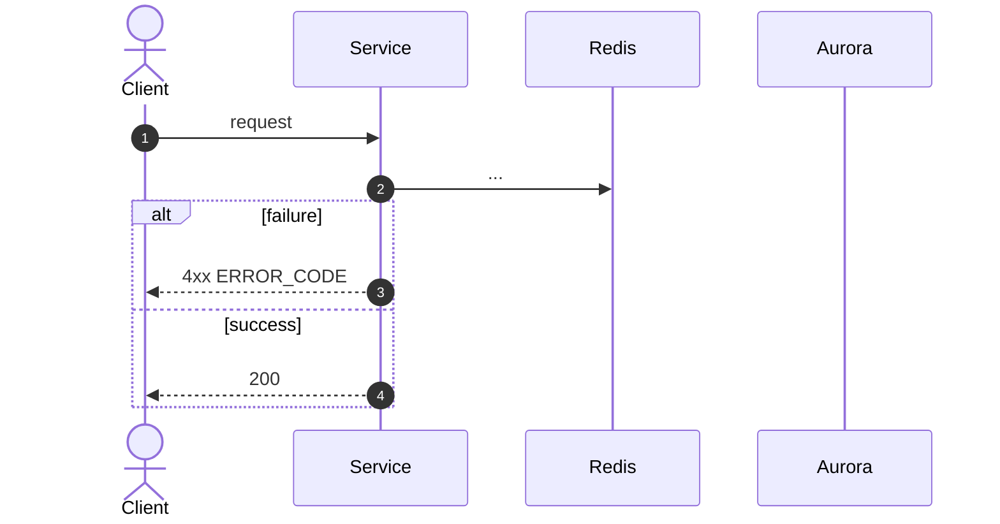

# <METHOD> <path> — <Apidog name>

| | |
|---|---|
| **Service** | `services/<name>` (Lambda / ECS) |
| **Auth** | <credential slot> |
| **Contract** | Apidog `<METHOD> <path>` · api-contracts §<n> |
| **Requirements** | FR-.. · BR-.. · NFR-.. |
| **Status** | planning / in progress / done |

## 1. Purpose

<one paragraph: what this endpoint does and why it exists>

## 2. Flow

## 3. Steps

1. ...

## 4. Data touched

| Store | Key / table | Op | Notes |
|---|---|---|---|

## 5. Responses and errors

| HTTP | Code | When |
|---|---|---|

## 6. Edge cases and decisions

- **OPEN:** ...

## 7. Tests

- [ ] unit: ...
- [ ] integration (Redis / Postgres via docker compose): ...
- [ ] concurrency: ...

## 8. Tasks

- [ ] ...
