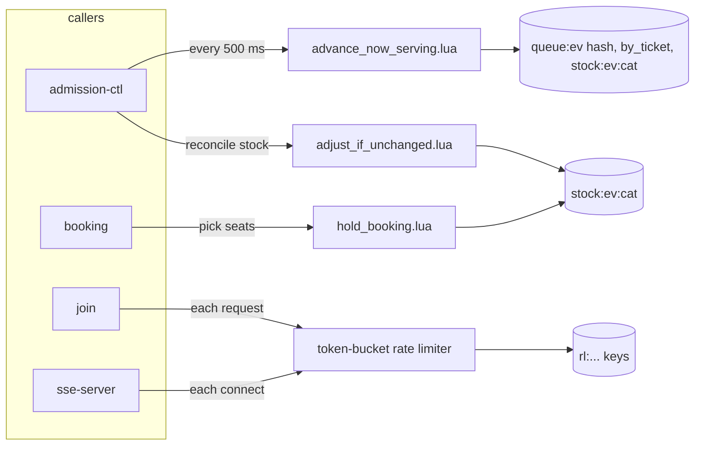

# Lua scripts

One place to see every Redis Lua script: what it is for, who calls it, and when.
Redis keys are in [`redis-keys.md`](redis-keys.md). Rules for each script live in its Gherkin feature, not here.

Sources: ADR-006 §3.4, §4.1, §8.11, §8.12 · HLD §8 · implementation-plan §14 (queue sections stale, see the note at the end).

## 1. At a glance

| Script | Status | Caller | When | What for |
|---|---|---|---|---|
| `advance_now_serving.lua` | **built** (`pkg/redisscript`) | admission-ctl only | every 500 ms tick, per event | decide how many people to let in, raise `now_serving`, record `free_slots` |
| `hset_if_exists.lua` | **built** (`pkg/redisscript`) | admission-ctl (FINISH) | after a customer's booking row exists | copy the grant into `token:<queue_token>` only if that hash still exists, so an expired token is never recreated without a TTL |
| token-bucket rate limiter | **built** (Lua embedded in `pkg/ratelimit/ratelimit.go`) | join (per IP and per account), sse-server (per IP); user and nik-verify have their own limiters | on every request that passes a limiter | refill the bucket by elapsed time and take one token, atomically |
| `hold_booking.lua` | planned (booking plan) | booking service | when a customer picks seats | reserve stock across categories, all or nothing |
| `adjust_if_unchanged.lua` | planned (admission-ctl plan) | admission-ctl, stock reconciliation | periodic correction of stock counters | correct a counter only if it still has the value that was read |

## 2. `advance_now_serving.lua`

**Spec:** `pkg/redisscript/features/advance_now_serving.feature` · **Code:** `pkg/redisscript/`

**What for.** It is the only place that moves `now_serving`. Admission-ctl calls it after counting who is inside in Aurora.

**When.** Once per tick (every 500 ms) for each event that is `SCHEDULED`, `OPEN` or `FULL_BOOKED`. Nothing else calls it: join, payment and cancel never grant and never wake the controller.

**In and out**

| | |
|---|---|
| KEYS | `queue:{ev}` (hash), `queue:{ev}:by_ticket`, `stock:{ev}:<category>`... |
| ARGV | `MAX_CONCURRENT_SLOTS`, `open` (incl. pending), `browsing` (incl. pending), `now_serving` the controller read, `now` (epoch s) |
| Returns | `{first_admitted, last_admitted, result_code, admitted_tokens}` |
| Writes | `queue:{ev}` fields `now_serving`, `free_slots`, `free_slots_at`, `state`, `full_booked_at` |

**What it decides, in order**

1. Reject bad arguments before any write.
2. If `now_serving` is no longer what the controller read, return `STALE` and write nothing (another writer got there first).
3. If the event is `CLOSED` or not seeded, return that and write nothing.
4. Sum the stock keys. A missing key, or no stock keys at all, returns `STOCK_UNINITIALIZED`.
5. `SCHEDULED`: only record `free_slots`, so join can send the first batch straight in at sale start.
6. Stock is zero: flip `OPEN` → `FULL_BOOKED` and stamp `full_booked_at`. Stock back: flip to `OPEN`.
7. Admit `min(MAX − open, ceil(stock / 3) − browsing)` ticket numbers, never past `issued`.
8. Record `free_slots` (places this run could not fill) and `free_slots_at`.

It never removes tokens from `by_ticket`. A member whose score is ≤ `now_serving` is a *pending grant*; admission-ctl writes its GRANTED row, then ZREMs it.

**Result codes:** `ADMITTED`, `NOOP`, `EMPTY`, `STALE`, `FULL_BOOKED`, `SCHEDULED`, `CLOSED`, `MISSING`, `STOCK_UNINITIALIZED`.

## 3. Token-bucket rate limiter

**Code:** `pkg/ratelimit/ratelimit.go`. Keys are `rl:*` (see `redis-keys.md`).

**What for.** Limit how often one caller can hit an endpoint.

**When.** On each request that passes a limiter, one atomic call refills the bucket by the time elapsed and takes a token. If the bucket is empty the caller gets a 429.

Join and sse-server use `pkg/ratelimit`. The user and nik-verify services have their own limiters, which are Handoko's work and not covered here.

## 4. `hold_booking.lua` (planned)

**What for.** Reserve seats when a customer picks them. It checks **all** categories before decrementing **any** (all or nothing), sets the NIK lock with `SET NX` and rolls back if a later step fails. A missing stock key is not zero.

**When.** When a customer reserves seats (`POST /bookings` in the booking plan). Which status change it belongs to is the booking plan's to settle.

**Spec:** not written yet (booking plan). Touches `stock:{ev}:<category>`, which `advance_now_serving.lua` also reads, so the stock keys must stay in one slot with the event hash tag.

## 5. `adjust_if_unchanged.lua` (planned)

**What for.** Correct a stock counter that drifted, but only if it still holds the value the caller read. A double run therefore never corrects twice.

**When.** Admission-ctl's periodic stock reconciliation.

**Spec:** not written yet (admission-ctl plan).

## 6. How scripts are loaded

- Scripts live in `pkg/redisscript` only. Do not copy them into services or documents.
- Each script is loaded once and called by SHA (`EVALSHA`). If Redis lost it (restart, `SCRIPT FLUSH`, failover) the call falls back to `EVAL` once, which also reloads it on the shard that lost it.
- Every key of one call shares the `{ev}` hash tag, so Redis cluster accepts the call.
- A script must never mix event keys with per-customer keys such as `token:<uuid>` or `grant:<token>`; those carry no hash tag.

## 7. Notes

- `implementation-plan.md` §14.1 still lists four callers for `advance_now_serving.lua` (admission-ctl, join, payment-api, outbox-publisher). ADR-006 §4.1 reduced it to **admission-ctl only**. Trust the ADR.
- Only `advance_now_serving.lua` has a `.lua` file today. The rate limiter's script is a Go string inside `pkg/ratelimit`.
