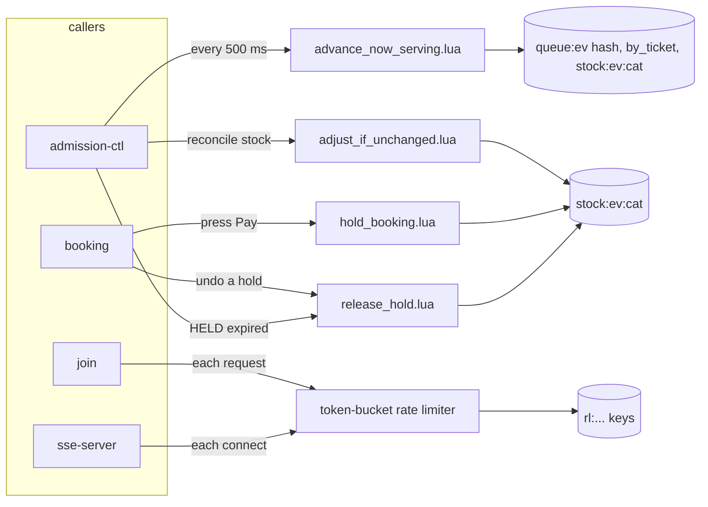

# Lua scripts

One place to see every Redis Lua script: what it is for, who calls it, and when.
Redis keys are in [`redis-keys.md`](redis-keys.md). Rules for each script live in its Gherkin feature, not here.

Sources: ADR-006 §3.4, §4.1, §8.12 (§8.11 `free_slots` removed by §8.14) · HLD §8 · implementation-plan §14 (queue sections stale, see the note at the end).

## 1. At a glance

| Script | Status | Caller | When | What for |
|---|---|---|---|---|
| `advance_now_serving.lua` | **built** (`pkg/redisscript`) | admission-ctl only | every 500 ms tick, per event | decide how many people to let in, raise `now_serving` |
| `hset_if_exists.lua` | **built** (`pkg/redisscript`) | admission-ctl (FINISH) | after a customer's booking row exists | copy the grant into `token:<queue_token>` only if that hash still exists, so an expired token is never recreated without a TTL |
| token-bucket rate limiter | **built** (Lua embedded in `pkg/ratelimit/ratelimit.go`) | join (per IP and per account), sse-server (per IP); user and nik-verify have their own limiters | on every request that passes a limiter | refill the bucket by elapsed time and take one token, atomically |
| `hold_booking.lua` | built (`05-booking/02-create-booking.md`) | booking service | the customer presses Pay (`POST /bookings`) | reserve stock across categories and lock every seat's NIK, all or nothing |
| `release_hold.lua` | built (same plan) | booking service, admission-ctl | the booking transaction fails after the hold, or a `HELD` booking expires | give the stock back and delete the NIK locks |
| `adjust_if_unchanged.lua` | built (`05-booking/04-stock-reconciliation.md`) | admission-ctl, stock reconciliation | periodic correction of stock counters | correct a counter only if it still has the value that was read |

## 2. `advance_now_serving.lua`

**Spec:** `pkg/redisscript/features/advance_now_serving.feature` · **Code:** `pkg/redisscript/`

**What for.** It is the only place that moves `now_serving`. Admission-ctl calls it after counting who is inside in Aurora.

**When.** Once per tick (every 500 ms) for each event that is `SCHEDULED`, `OPEN` or `FULL_BOOKED` (an unopened event must already be known when it opens, because discovery runs every 30 s). Nothing else calls it: join, payment and cancel never grant and never wake the controller.

**In and out**

| | |
|---|---|
| KEYS | `queue:{ev}` (hash), `queue:{ev}:by_ticket`, `stock:{ev}:<category>`... |
| ARGV | `MAX_CONCURRENT_SLOTS`, `open` (incl. pending), `browsing` (incl. pending), `now_serving` the controller read, `now` (epoch s) |
| Returns | `{first_admitted, last_admitted, result_code, admitted_tokens}` |
| Writes | `queue:{ev}` fields `now_serving`, `state`, `full_booked_at` |

**What it decides, in order**

1. Reject bad arguments before any write.
2. If `now_serving` is no longer what the controller read, return `STALE` and write nothing (another writer got there first).
3. If the event is `CLOSED` or not seeded, return that and write nothing.
4. Sum the stock keys. A missing key, or no stock keys at all, returns `STOCK_UNINITIALIZED`.
5. `SCHEDULED`: return `SCHEDULED`, write nothing (the first tick after the state turns `OPEN` admits at once).
6. Stock is zero: flip `OPEN` → `FULL_BOOKED` and stamp `full_booked_at`. Stock back: flip to `OPEN`.
7. Admit `min(MAX − open, ceil(stock / 3) − browsing)` ticket numbers, never past `issued`.

It never removes tokens from `by_ticket`. A member whose score is ≤ `now_serving` is a *pending grant*; admission-ctl writes its GRANTED row, then ZREMs it.

**Result codes:** `ADMITTED`, `NOOP`, `EMPTY`, `STALE`, `FULL_BOOKED`, `SCHEDULED`, `CLOSED`, `MISSING`, `STOCK_UNINITIALIZED`.

## 3. Token-bucket rate limiter

**Code:** `pkg/ratelimit/ratelimit.go`. Keys are `rl:*` (see `redis-keys.md`).

**What for.** Limit how often one caller can hit an endpoint.

**When.** On each request that passes a limiter, one atomic call refills the bucket by the time elapsed and takes a token. If the bucket is empty the caller gets a 429.

Join and sse-server use `pkg/ratelimit`. The user and nik-verify services have their own limiters, which are Handoko's work and not covered here.

## 4. `hold_booking.lua` and `release_hold.lua`

**Spec:** `docs/05-booking/02-create-booking.md` §3.2 · **Code:** `pkg/redisscript/hold_booking.lua`, `release_hold.lua`, `hold.go` (`Hold`, `Release`)

**`hold_booking.lua` — what for.** Take the seats when the customer presses Pay. Three phases, in one atomic call:
1. check **every** category has enough stock (a missing key is `STOCK_UNINITIALIZED`, not zero) before changing anything;
2. lock each seat's NIK with `SET NX EX`; one already taken undoes the locks made so far;
3. decrement the stock; a negative count (`STOCK_NEGATIVE`) undoes everything.

It answers `{code, index}`: `HELD`, `NO_STOCK` (category index), `STOCK_UNINITIALIZED` (category index; it wins over a
category that is merely short), `NIK_TAKEN` (seat index), `STOCK_NEGATIVE` (category index, everything undone), or a
guard (`QTY_INVALID`, `QTY_EXCEEDED`, `NIK_COUNT_MISMATCH`). A stock value that is not a plain integer counts as
`STOCK_UNINITIALIZED`. Indexes count from 0 in the order of the request. It never
touches `queue:{ev}`.

**Call shape.** `KEYS` = `stock:{ev}:<cat>` per category, then `nik:used:{ev}:<hmac>` per seat. `ARGV` = number of
categories, number of NIKs, the per-order limit, the NIK lock TTL in seconds, then one quantity per category. A category
appears once per call (booking adds up the seats of a category); a repeat that would drive the stock below zero is
caught by `STOCK_NEGATIVE`. The NIK lock TTL is required: a lock without an expiry would live for ever.

**When.** Once per `POST /bookings`, inside the booking transaction, after the booking row is locked (the booking moves
`SELECTING → HELD`).

**`release_hold.lua` — what for.** The reverse: add the stock back and delete the NIK locks, in one call. Used when the
booking transaction fails after the hold, and by the HELD → EXPIRED sweep. **Call it once per hold:** it adds the stock
back every time it runs; a crash between the commit and the release is repaired by stock reconciliation (B5), not by
running it twice. It returns `{niks_deleted, stock_missing}`. A stock key that is gone is **not** recreated (the next
hold then answers `STOCK_UNINITIALIZED` instead of selling a made-up count; reconciliation restores it), and every
argument is checked before anything is written.

**Keys.** `stock:{ev}:<category>` per category and `nik:used:{ev}:<hmac>` per seat. All carry the `{ev}` hash tag, so one
call can touch them in the cluster. `advance_now_serving.lua` also reads the stock keys.

## 5. `adjust_if_unchanged.lua`

**What for.** Correct a stock counter that drifted, but only if it still holds the value the caller read. A double run therefore never corrects twice.

**When.** The periodic stock reconciliation (step B5 in `05-booking/README.md`).

**Spec:** `docs/05-booking/04-stock-reconciliation.md` §4.1 · **Code:** `pkg/redisscript/adjust_if_unchanged.lua`, `adjust.go` (`AdjustIfUnchanged`).

**Call shape.** `KEYS` = the one `stock:{ev}:<cat>` key. `ARGV` = the value the caller read, the delta. It answers `{code, value}`: `ADJUSTED` (the key held the observed value and the result is not below zero), `CHANGED` (it moved since: nothing written), `MISSING` (gone, or not a plain integer: nothing written, the caller restores it with `SET NX`) or `BELOW_ZERO` (nothing written). It writes only its own key and never creates it.

## 6. How scripts are loaded

- Scripts live in `pkg/redisscript` only. Do not copy them into services or documents.
- Each script is loaded once and called by SHA (`EVALSHA`). If Redis lost it (restart, `SCRIPT FLUSH`, failover) the call falls back to `EVAL` once, which also reloads it on the shard that lost it.
- Every key of one call shares the `{ev}` hash tag, so Redis cluster accepts the call.
- A script must never mix event keys with per-customer keys such as `token:<uuid>` or `grant:<token>`; those carry no hash tag.

## 7. Notes

- `implementation-plan.md` §14.1 still lists four callers for `advance_now_serving.lua` (admission-ctl, join, payment-api, outbox-publisher). ADR-006 §4.1 reduced it to **admission-ctl only**. Trust the ADR.
- Only `advance_now_serving.lua` has a `.lua` file today. The rate limiter's script is a Go string inside `pkg/ratelimit`.
