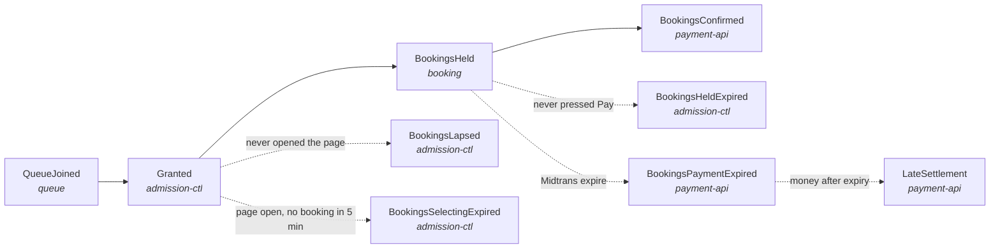

# Metrics — catalogue, formulas and queries

| | |
|---|---|
| **Services** | `queue`, `booking`, `payment-api`, `admission-ctl`, `sse-server`, `pkg/emf` |
| **Requirements** | FR-33 (active queue) · FR-34 (conversion queue → purchase) · FR-35 (expiry rate) · FR-36 (disputed list) · NFR-06 (p95 < 1 s) · NFR-09 (real-time observability) · NFR-10 (email DLQ) · NFR-14 (`CtlHeartbeatAge`) |
| **Sources** | impl-plan §8.6 (`CtlHeartbeatAge`), §12 (`metrics-scraper`, replaced here) · `TODO-WRAPUP.md` T8 (emit), T9 (dashboard + alarms) |
| **Status** | Part A (emit) built; Part B (dashboard, alarms) next |

## 1. Purpose

The requirements ask for three business numbers per event: how many people are waiting (FR-33), how many of them
end up buying (FR-34) and how many bookings run out unpaid (FR-35). The services already know each of these at the
moment it happens (a ticket number is issued, a booking is confirmed, a sweep expires a booking), so **each service
counts its own transitions** as CloudWatch EMF log lines. The dashboard divides the counts. No `metrics-scraper` Lambda
(impl-plan §12): it would re-read Aurora and Redis for numbers the services already have.

Example: event `evt-123` sells out. Over the sale the logs hold 3,000 `QueueJoined`, 400 `Granted`, 300 `BookingsHeld`,
100 `BookingsConfirmed`. Conversion = 100 / 3,000 = **3.3 %**. If 120 of the 300 held bookings expired, expiry rate =
120 / 300 = **40 %**.

### 1.1 Dashboard outline

One CloudWatch dashboard, `rusuh-{env}-sale`, read top to bottom: *is the sale healthy at a glance → is the queue
moving → are people buying → is the system coping → is any money or stock at risk*. The grid is 24 columns wide; the
time range is set to the sale window.

```
┌──────────────────────────────────────────────────────────────────────────────────────────┐
│ 0  HEADER (text): what this board is · set time range = sale window · link to RUNBOOK    │
├──────────────┬──────────────┬──────────────┬──────────────┬──────────────┬───────────────┤
│ 1  Waiting   │ Joined       │ Confirmed    │ Conversion % │ Expiry %     │ Alarm status  │
│    now       │              │              │ (FR-34)      │ (FR-35)      │ (all alarms)  │
│    (FR-33)   │              │              │              │              │               │
├──────────────┴──────────────┼──────────────┴──────────────┼──────────────┴───────────────┤
│ 2  QUEUE (FR-33)            │                             │                              │
│ Waiting per event           │ Now serving vs issued       │ Admission rate (per min)     │
│ (one line per EventId)      │ per event                   │ + SSE connections            │
├─────────────────────────────┴─────────────────────────────┼──────────────────────────────┤
│ 3  FUNNEL (FR-34, FR-35)                                  │                              │
│ Per-event table: Joined · Granted · Held · Confirmed ·    │ Where people drop out        │
│ Conversion % · Grant use % · Expiry %                     │ (bars: Lapsed · Selecting ·  │
│                                                           │  Held · Payment expired)     │
├──────────────┬──────────────┬──────────────┬──────────────┴──────────────┬───────────────┤
│ 4  HEALTH (NFR-06, NFR-14)  │              │                             │               │
│ API p95      │ API 5xx /    │ Queue        │ admission-ctl tick          │ Redis CPU/mem │
│ latency      │ Lambda errors│ freshness    │ duration + overruns         │ Aurora ACU /  │
│ (line at 1s) │ + throttles  │ (line at 30s)│                             │ connections   │
├──────────────┴──────────────┴──────────────┼─────────────────────────────┴───────────────┤
│ 5  MONEY & STOCK (NFR-04, NFR-10, FR-36)   │                                             │
│ Stock safety: drift · negative ·           │ Disputed bookings table (FR-36):            │
│ hold unknown · release failed              │ time · event · booking · order_id · amount  │
│ Late settlements · email DLQ depth         │                                             │
└────────────────────────────────────────────┴─────────────────────────────────────────────┘
```

| Row | Widget | Type | Source | Answers |
|---|---|---|---|---|
| 0 | Header | text | markdown | how to read the board |
| 1 | Waiting now | single value | `SUM(SEARCH(QueueDepth))`, Maximum, 1 min | FR-33, all events |
| 1 | Joined, Confirmed | single value | `QueueJoined`, `BookingsConfirmed` (no-dimension total), Sum, period = time range | funnel ends |
| 1 | Conversion %, Expiry % | single value | metric math on the totals (§4), period = time range | FR-34, FR-35 |
| 1 | Alarm status | alarm status | the alarms in §8 | "is anything red?" |
| 2 | Waiting per event | line | `SEARCH('{Rusuh/Admission,EventId} MetricName="QueueDepth"', 'Maximum', 60)` | FR-33 per event |
| 2 | Now serving vs issued | line | `SEARCH` on `NowServing` and `Issued` | is the queue moving? |
| 2 | Admission rate, SSE connections | line | `RatePerMin`, `SSEConnections` per event | speed and audience |
| 3 | Per-event funnel | Logs Insights table | §7 funnel query | FR-34, FR-35 per event |
| 3 | Where people drop out | bar | `BookingsLapsed`, `BookingsSelectingExpired`, `BookingsHeldExpired`, `BookingsPaymentExpired`, Sum | FR-35 by stage |
| 4 | API p95 latency | line + 1 s annotation | API Gateway `Latency` p95 | NFR-06 |
| 4 | Errors | line | API Gateway 5xx, Lambda `Errors`, `Throttles` | overload |
| 4 | Queue freshness | line + 30 s annotation | `CtlHeartbeatAge` Minimum and Maximum | NFR-14 |
| 4 | Tick | line | `TickDurationSeconds`, `TickOverrun` | admission-ctl keeping up |
| 4 | Redis, Aurora | line | ElastiCache `EngineCPUUtilization`, memory; Aurora `ServerlessDatabaseCapacity`, `DatabaseConnections` | capacity |
| 5 | Stock safety | line | `StockDrift`, `StockNegative`, `HoldCommitUnknown`, `ReleaseFailed` | NFR-04, no oversell |
| 5 | Late settlements, DLQ | line | `LateSettlement`; SQS `ApproximateNumberOfMessagesVisible` on the DLQs | money after expiry, NFR-10 |
| 5 | Disputed bookings | Logs Insights table | §7 disputed query | FR-36 |

Row 1 tiles use "period = time range" so they show the whole sale, not the last minute. Rows 2 and 4 are over time;
rows 3 and 5 tables are totals for the time range.

**Per event.** The board has an **event dropdown** at the top (a CloudWatch dashboard variable named `EventId`, its
choices filled from the `EventId` values of `QueueJoined`). What each row does with it:

| Row | Grouping |
|---|---|
| 1 Headline tiles | **the selected event** (`QueueDepth`, `QueueJoined`, `BookingsConfirmed`, … with `EventId = <selected>`) |
| 2 Queue | **one line per event**, all events side by side; the selected event is the one to read |
| 3 Funnel | per-event table: **one row per event**; drop-out bars for **the selected event** |
| 4 Health | **all events together**: API Gateway, Lambda, Redis, Aurora and admission-ctl are shared by every sale |
| 5 Money & stock | stock safety **all events** (alarms watch the total); disputed table **one row per booking**, with its `event_id` column |

Example: two sales open, `evt-123` (800 waiting) and `evt-456` (50 waiting). Pick `evt-123` in the dropdown: the tiles
show 800 waiting and `evt-123`'s conversion and expiry; row 2 still draws both lines; row 3's table still lists both
events.

Logs Insights widgets do not follow a metric dimension variable by themselves. The row 3 and row 5 tables list every
event (one row each, grouped by `EventId`). They are filtered by the dropdown only if step 7 (§10) shows a text
(pattern) variable can be put into their query.

## 2. Funnel and who counts what



Self-check the dashboard can show: `Granted ≈ Lapsed + SelectingExpired + Held + still open`, and
`Held ≈ Confirmed + HeldExpired + PaymentExpired + still open`. A gap that does not close after the sale means a
missing count.

## 3. Rules

1. **Count after commit, once per real transition.** A counter is written only after the database change committed
   and only when this call made the change: a re-join, an idempotent `POST /bookings` retry (`AlreadyPlaced`) or a
   Midtrans webhook retry (`out.Applied == false`) writes nothing.
2. **Dimensions: `EventId` only**, on per-event metrics. Never booking id, NIK, email, account or token: each distinct
   value is a separate billed CloudWatch metric and some of them are personal data (NFR-11).
3. **Each per-event line declares two dimension sets, `[["EventId"], []]`.** The same log line then feeds the per-event
   metric *and* the all-events total, so alarms can use the total without metric math. No extra log volume. The total
   is meaningful for **counts** only; for gauges (`QueueDepth`, …) it mixes the events' samples, so totals of gauges
   are summed from the per-event series (`SUM(SEARCH(...))`).
4. **Counts are approximate; Aurora is exact.** A crash between commit and the log write loses one count. The
   dashboard is for watching the sale; the final numbers for a report come from Aurora (§7, last query).
5. Health and failure counters (`TickOverrun`, `HoldCommitUnknown`, …) keep **no** dimension unless they are per event
   by nature. They feed alarms on the total.
6. Namespaces stay one per service: `Rusuh/Queue`, `Rusuh/Booking`, `Rusuh/Events`, `Rusuh/SSE`, and new
   `Rusuh/Admission`, `Rusuh/Payment`.

## 4. Formulas

| Req | Number | Formula | Statistic and period |
|---|---|---|---|
| FR-33 | Active queue | `QueueDepth` = `issued − now_serving` (gauge) | Maximum, 1 min |
| FR-34 | Conversion | `BookingsConfirmed / QueueJoined × 100` | Sum over the **whole sale window** |
| FR-34 | Grant use (ops) | `BookingsConfirmed / Granted × 100` | Sum over the sale window |
| FR-35 | Expiry rate | `(BookingsHeldExpired + BookingsPaymentExpired) / BookingsHeld × 100` | Sum over the sale window |
| FR-35 | Expiry by stage | `BookingsLapsed / Granted`, `BookingsSelectingExpired / Granted`, `BookingsHeldExpired / BookingsHeld`, `BookingsPaymentExpired / BookingsHeld` | Sum over the sale window |
| NFR-06 | Queue latency | API Gateway `Latency` p95 on `/queue/*` and `/events*` < 1 s (built-in, no code) | p95, 1 min |
| NFR-14 | Queue freshness | `CtlHeartbeatAge` = `now − lastBroadcastAt[event]` (sse-server, existing) | **Minimum** across tasks > 30 s = admission-ctl down; Maximum > 30 s = one task cut off |

Ratios are computed over the **sale window, never per minute**: a booking held at minute 1 may confirm at minute 9, so a
per-minute ratio jumps around and can exceed 100 %.

`QueueJoined` counts **places in the line, not people**: someone whose booking ended and who joins again gets a new
place (ADR-006 §8.21) and counts again. The FR-34 headline divides by `QueueJoined`: FR-34 says "antrian → pembelian", and the 23 Oct example "antrian 3.000 →
sukses beli 100" divides by people who joined. `Confirmed / Granted` is shown next to it as an ops number.

## 5. Catalogue

New or changed. `D` = dimension sets `[["EventId"], []]`. Everything else stays as emitted today.

| Metric | Namespace | Unit | Dim | Emitted by, where | Status |
|---|---|---|---|---|---|
| `QueueJoined` | `Rusuh/Queue` | Count | D | `queue` `usecase/join.go` `issue` (new ticket only, not `rejoin`) | new |
| `Granted` | `Rusuh/Admission` | Count | D | `admission-ctl` `tick.go` `finish`, after `InsertGranted` succeeds | new |
| `BookingsHeld` | `Rusuh/Booking` | Count | D | `booking` `POST /bookings`, result `Placed` only | new |
| `BookingsConfirmed` | `Rusuh/Payment` | Count | D | `payment-api` `webhook.go`, `Applied && ActionConfirm` | new |
| `BookingsPaymentExpired` | `Rusuh/Payment` | Count | D | `payment-api` `webhook.go`, `Applied && ActionExpire` | new |
| `LateSettlement` | `Rusuh/Payment` | Count | D | `payment-api` `webhook.go`, `ActionLateSettlement` (next to the existing `LatePaymentRefund` log line); one per late notification, so one booking can count twice (e.g. `capture` then `settlement`); the alarm is `> 0`, exact list from Aurora | new |
| `MidtransErrors` | `Rusuh/Payment` | Count | — | `payment-api` failed charge (`initiate.go`) or cancel (`retry.go`); a cancel refused because the payment is already paid is not an error | new |
| `BookingsLapsed` | `Rusuh/Admission` | Count | D | `admission-ctl` sweep (existing name) | logged only → EMF + dim |
| `BookingsSelectingExpired` | `Rusuh/Admission` | Count | D | `admission-ctl` sweep (existing name) | logged only → EMF + dim |
| `BookingsHeldExpired` | `Rusuh/Admission` | Count | D | `admission-ctl` HELD sweep (existing name) | logged only → EMF + dim |
| `QueueDepth` | `Rusuh/Admission` | None | D | `admission-ctl` tick, `issued − now_serving` | logged only, **no event** → EMF + dim |
| `NowServing`, `Issued` | `Rusuh/Admission` | None | D | `admission-ctl` tick, from `Snapshot` | new |
| `RatePerMin` | `Rusuh/Admission` | None | D | `admission-ctl` tick, the rate the last tick published | new |
| `TickDurationSeconds` | `Rusuh/Admission` | Seconds | — | `admission-ctl` tick, whole loop | new |
| other admission-ctl counters (`TickOverrun`, `StockDrift`, `ReleaseFailed`, `NikOrphans`, …) | `Rusuh/Admission` | as today | — | unchanged call sites | logged only → EMF |
| `CtlHeartbeatAge`, `SSEConnections` | `Rusuh/SSE` | as today | `Event` → `EventId` | `sse-server` | dimension rename |

Gauges in admission-ctl are written **at most once per 10 s per event** (the broadcast heartbeat), not every 500 ms
tick: CloudWatch keeps 1-minute resolution anyway. `QueueDepth`, `NowServing` and `Issued` are the values the tick read
at SNAPSHOT, so they always agree with each other; `RatePerMin` is the rate the last tick published.
`TickDurationSeconds` is the slowest whole tick of each 10 s window (the name ends in `Seconds` so `pkg/emf` gives it
the Seconds unit).

sse-server's dimension is renamed from `Event` to `EventId`, so every service uses one name. There is no `TaskId`
dimension (impl-plan §8.6 lists one): every sse-server task writes into the same metric, so the Minimum of a minute is
already the freshest age *any* task saw (> 30 s means none is receiving) and the Maximum the stalest.

`ABANDONED` (payment-api status) has no counter: it is not one of the FR-35 stages. Add `BookingsAbandoned` only if the
self-check in §2 does not close.

Not emitted, because no widget or alarm uses them: `Browsing`, `OpenBookings`, `PaymentInitiated`, `PaymentDeclined`.

## 6. Code changes

### 6.1 `pkg/emf`

Add per-event variants next to the existing methods; existing callers keep working.

```go
func (e *EMF) IncrEvent(name, eventID string)                  // Count, dims [["EventId"], []]
func (e *EMF) RecordEvent(name, eventID string, value float64) // unit rule as Record
```

The line carries `"EventId": "<id>"` as a top-level field, so Logs Insights can group by it (§7).

### 6.2 `admission-ctl`

- Replace `logMetrics` in `cmd/worker/main.go` with an adapter over `pkg/emf` (`Rusuh/Admission`).
- Extend the `outbound.Metrics` port with `IncEvent(name, eventID)` and `GaugeEvent(name, eventID, value)`; call sites
  that have an event (`ev.ID`, `h.EventID`, `b.EventID`) use them.
- **`QueueDepth` is per event.** Today `RunEvent` reads `issued` and `now_serving` for `ev.ID` and then calls
  `Gauge(GaugeQueueDepth, depth)` without it (`tick.go`, after `Snapshot`). With two live sales the values of both land
  in one metric: Maximum shows only the busier event, Average a number that belongs to neither. It becomes
  `GaugeEvent(GaugeQueueDepth, ev.ID, depth)`, and the plain `Gauge` is kept only for metrics that are not about one
  event (`StockDrift`, `NikOrphans`, `TickDurationSeconds`).
- `NowServing`, `Issued` and `RatePerMin` follow the same rule: written from `RunEvent` with
  `ev.ID`.
- Locally the EMF lines go to stdout, as in every other service; there is no separate local format.

### 6.3 `queue`, `booking`, `payment-api`

- `queue`, `booking`: one `IncrEvent` each at the points in §5.
- `payment-api`: an `IMetrics` port (`Incr`, `IncrEvent`), passed to `usecase.New`; `internal/delivery/server.go`
  wires `emf.New("Rusuh/Payment", os.Stdout)`. `MidtransErrors` counts a failed charge (`initiate.go`) or cancel
  (`retry.go`) call.

## 7. Queries

**Per-event funnel (FR-33–35), Logs Insights.** Select the log groups of the `queue`, `booking`, `payment-api` Lambdas
and the `admission-ctl` ECS task; time range = the sale.

```
filter ispresent(EventId)
| stats sum(QueueJoined)            as joined,
        sum(Granted)                as granted,
        sum(BookingsHeld)           as held,
        sum(BookingsConfirmed)      as confirmed,
        sum(BookingsHeldExpired)    as held_expired,
        sum(BookingsPaymentExpired) as pay_expired
  by EventId
| fields EventId, joined, granted, held, confirmed,
         confirmed * 100 / joined                   as conversion_pct,
         confirmed * 100 / granted                  as grant_use_pct,
         (held_expired + pay_expired) * 100 / held  as expiry_pct
| sort joined desc
```

**Live queue per event, dashboard metric search:**

```
SEARCH('{Rusuh/Admission,EventId} MetricName="QueueDepth"', 'Maximum', 60)
```

One line per event; a new event shows up without editing the dashboard. Same pattern for `NowServing`, `Issued`,
`RatePerMin`.

**Disputed list (FR-36), Logs Insights on `payment-api`:**

```
filter alarm = "LatePaymentRefund"
| fields @timestamp, event_id, booking_id, order_id, gross_amount
| sort @timestamp desc
```

FR-36 (`order_id` and amount) is served by this query, with `event_id` and `gross_amount` added to the existing
`LatePaymentRefund` log line. `GET /admin/reconciliation/disputed` stays in the contract as not built.

**Exact totals after the sale, Aurora:**

```sql
SELECT status, COUNT(*) FROM bookings WHERE event_id = $1 GROUP BY status;
```

## 8. Dashboard and alarms (T9, for reference)

Built in T9 from these names. The dashboard layout is §1.1.

- Alarms to one SNS topic, email: `CtlHeartbeatAge` Minimum > 30 s, `StockNegative` > 0, `LateSettlement` > 0,
  DLQ depth > 0, API 5xx > 1 %, `TickOverrun` sustained.

The `CtlHeartbeatAge` threshold is **30 s** (NFR-14, impl-plan §8.6): three missed 10 s heartbeats, and a leader
handover fits inside it.

## 9. Tests

- [x] `pkg/emf`: an event line declares dimension sets `[["EventId"], []]` and carries the `EventId` field
- [x] `pkg/emf`: existing `Incr` / `Record` lines are unchanged
- [x] queue: a new join counts `QueueJoined` once for its event
- [x] queue: a re-join with a live token counts nothing
- [x] queue: a refused join counts nothing
- [x] admission-ctl: a granted place counts `Granted` once for its event
- [x] admission-ctl: a failed grant insert counts `GrantInsertFailures` and not `Granted`
- [x] admission-ctl: a grant whose row an earlier tick saved is not counted again
- [x] admission-ctl: each sweep counts its ended bookings under their own event
- [x] admission-ctl: queue depth is reported per event, so two live sales give two separate values
      (event A 800 waiting, event B 50 waiting → `QueueDepth{EventId=A}` = 800 and `QueueDepth{EventId=B}` = 50)
- [x] admission-ctl: queue depth is `issued − now_serving` and never below zero
- [x] admission-ctl: gauges are written at most once per 10 s per event, not every tick
- [x] admission-ctl: tick duration is the slowest tick of each 10 s window
- [x] admission-ctl: the EMF adapter writes `Rusuh/Admission` lines
- [x] booking: a placed booking counts `BookingsHeld` once
- [x] booking: an idempotent retry of a placed booking counts nothing
- [x] booking: a refused booking counts nothing
- [x] payment-api: an applied settlement counts `BookingsConfirmed` once
- [x] payment-api: a repeated settlement notification counts nothing
- [x] payment-api: a settlement that changed nothing counts nothing
- [x] payment-api: an applied expire counts `BookingsPaymentExpired`
- [x] payment-api: a late settlement counts `LateSettlement` and logs `event_id` and `gross_amount`
- [x] payment-api: a failed charge or cancel counts a Midtrans error; a successful charge does not
- [x] payment-api: a cancel refused because the payment is already paid is not a Midtrans error
- [x] sse-server: heartbeat age and connections use the `EventId` dimension

## 10. Build steps

Follow in order; each step says how to know it is done. **Stop** marks a point where the work waits for approval.
Estimates add up to about 5 h; the short cut at the end covers every MUST in about 3.5 h.

```mermaid
flowchart LR
    S1["1. Approve plan<br/>(stop)"] --> S2["2. pkg/emf"] --> S3["3. Services emit"] --> S4["4. Local check"]
    S4 --> S5["5. Verify<br/>(stop)"] --> S6["6. Deploy to dev<br/>+ first data"] --> S7["7. Draft board<br/>in console"]
    S7 --> S8["8. Template"] --> S9["9. Alarms"] --> S10["10. CI"] --> S11["11. Two-event smoke"] --> S12["12. Alarm drill<br/>+ screenshots"]
```



### Part A — emit the metrics (T8, ~2.5 h)

- [x] **1. Approve this plan (stop).** All `OPEN:` items settled. Metric and dimension names are fixed from here on:
      the dashboard is built on them. Work on a branch from `main` (`feat/metrics`).
- [x] **2. `pkg/emf`** (~20 min): `IncrEvent`, `RecordEvent` (§6.1). *Done:* `pkg/emf` tests in §9 pass.
- [x] **3. Services emit** (~1.5 h), one module at a time with `make test-module MODULE=...`:
  - [x] admission-ctl: EMF adapter (`Rusuh/Admission`), per-event port methods, `QueueDepth` and the other gauges per
        event every 10 s, `Granted`, `TickDurationSeconds` (§6.2)
  - [x] queue: `QueueJoined`
  - [x] booking: `BookingsHeld`
  - [x] payment-api: metrics port + adapter, the payment counters, `event_id` and `gross_amount` on the
        `LatePaymentRefund` log line
  - [x] sse-server: dimension `Event` → `EventId`

  *Done:* each module's §9 tests pass.
- [ ] **4. Local check** (~15 min): run the stack (`make seed`), join, book, send a fake settlement webhook twice. In
      stdout, every `"_aws"` line of a per-event metric has an `EventId` field; the second webhook adds no
      `BookingsConfirmed` line; two seeded events give two `QueueDepth` values.
- [ ] **5. Verify (stop).** `make verify`; self-review against §3 rules and §9. Show `git status`, `git diff --stat`, the
      test names and the output; commit only after approval. Update `TODO-WRAPUP.md` T8 (conversion formula) and T9
      (heartbeat threshold) in the same step.

### Part B — dashboard and alarms (T9, ~2 h)

- [ ] **6. Deploy to dev and make first data.** CloudWatch creates a metric only on its first data point: until then
      `SEARCH` widgets are empty and Logs Insights cannot see the fields. Open a sale on two events, join, book, pay with
      the Midtrans sandbox, let one booking expire. *Done:* `Rusuh/Admission`, `Rusuh/Queue`, `Rusuh/Booking`,
      `Rusuh/Payment` appear under CloudWatch → Metrics, each with an `EventId` dimension.
- [ ] **7. Draft the board in the console** (~45 min): create `rusuh-dev-sale` with the rows and widgets of §1.1. Add
      the `EventId` dropdown variable and check the OPEN item in §1.1 (can the Logs Insights tables follow it?).
      Log groups for the Logs Insights widgets: `/aws/lambda/rusuh-dev-queue`, `/aws/lambda/rusuh-dev-booking`,
      `/aws/lambda/rusuh-dev-payment-api`, `/ecs/rusuh-dev/admission-ctl` (check the exact Lambda names in the console).
      *Done:* switching the dropdown changes row 1; row 2 shows one line per event; row 3 one row per event.
- [ ] **8. Move it into code** (~30 min): Actions → View/edit source, copy the JSON into
      `infra/observability/template.yaml` as an `AWS::CloudWatch::Dashboard`; replace `dev` with `${Environment}`
      (`!Sub`). *Done:* delete the console board, deploy the stack, the board comes back identical.
- [ ] **9. Alarms** (~30 min), same template: one `AWS::SNS::Topic` with the team's email subscription (each address
      confirms once) and the alarms of §8 on the all-events totals. `TreatMissingData: notBreaching` everywhere except
      `CtlHeartbeatAge`, where missing data during a sale means admission-ctl is gone. *Done:* the alarm status tile in
      row 1 lists every alarm as OK.
- [ ] **10. CI:** deploy `infra/observability` from `cicd.yml` like the ECS stack, on changes to
      `infra/observability/**`.

### Part C — prove it (~30 min)

- [ ] **11. Two-event smoke run:** row 2 draws two lines; row 3 has two rows; the §2 self-check closes for each event;
      the totals match `SELECT status, COUNT(*) FROM bookings WHERE event_id = $1 GROUP BY status`.
- [ ] **12. Alarm drill and screenshots:** stop admission-ctl for 40 s during a sale → `CtlHeartbeatAge` alarm email
      arrives, then clears. Screenshot the board and the email for the presentation.

**Short cut (~3.5 h, every MUST covered):** in step 3 only the funnel counters and the queue gauges; in step 7 only rows
0–3; in step 9 only `CtlHeartbeatAge`, `StockNegative` and `LateSettlement`.
