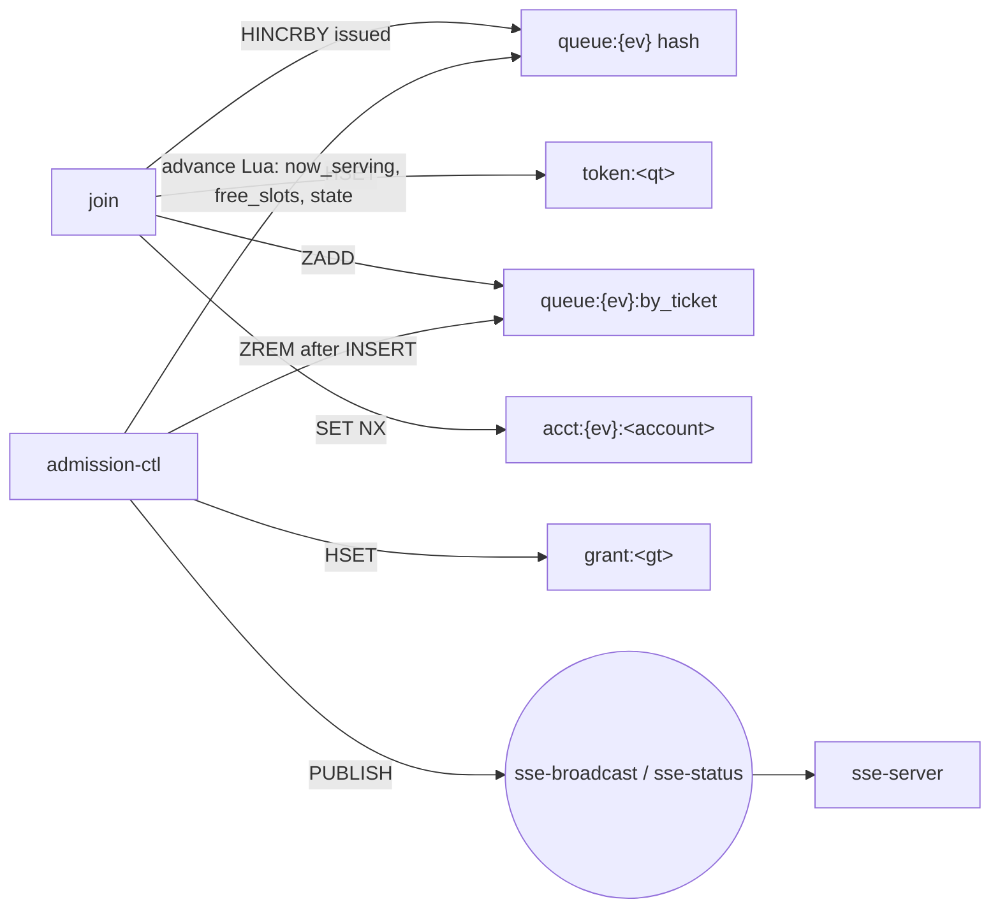

# Redis keys and channels

Every Redis key and pub/sub channel used by the backend, in one place. **The code is the
source:** queue-domain names are built only by [`pkg/rediskeys`](../pkg/rediskeys/rediskeys.go),
and a test there fails if a builder is missing from this page. Change both together.

## Rules

- **Never hand-write a key.** Add a builder to `pkg/rediskeys`, then a row here.
- **`{ev}` is the only hash tag.** Every per-event key carries `{<event_id>}`, so Redis cluster puts all of
  one event's keys in one slot and a Lua script or `WATCH`/`MULTI` may touch them together.
- **Per-customer keys have no event tag** (`token:`, `grant:`, `rl:`). Never mix them with `{ev}` keys in one
  script or transaction (cross-slot in cluster mode).
- **Never store raw personal data in a key or value.** Device ids are stored as `HMAC(DEVICE_PEPPER, id)`,
  NIKs as `nik_hmac`.
- **Never delete or overwrite `queue:{ev}`.** It holds the ticket counter (`issued`) and `state`. sale-ops seeds
  it with `HSETNX` (a second `seed` must not reset `issued`: reissued numbers would collide with `by_ticket`);
  cleaning up after the event deletes it only once the sale is over.
- **TTL:** every key without a natural end gets one. Keys of a live event (`queue:{ev}*`, `stock:`) do not
  expire; sale-ops cleans them up after the event.

Status: **built** = used by code on `main` or the current branch · **planned** = in the plans, no code yet.

## Queue domain (`pkg/rediskeys`)

| Key | Builder | Type | TTL | Written by | Read by | What it is | Status |
|---|---|---|---|---|---|---|---|
| `queue:{ev}` | `Event.QueueHash` | hash, fields below | none | see the field table | all queue services | The event's one hash: sale state, ticket counter, admission numbers and the fields join echoes back. **ADR-006 §8.12** merged `state`, `issued` and `full_booked_at` into it (one `HMGET` for join's snapshot) | built (join, sse-server read); `free_slots*`, `full_booked_at` writers planned |
| `queue:{ev}:by_ticket` | `Event.ByTicket` | zset, member `queue_token`, score `ticket_no` | none | join (`ZADD`; rejoin repair `ZADD NX` only while `ticket_no > now_serving`), admission-ctl (`ZREM` last, after the GRANTED row) | advance Lua, admission-ctl RECOVER, `/me` | The line. A score ≤ `now_serving` still present = pending grant (ADR-006 rule 4) | built (join side) |
| `stock:{ev}:<category>` | `Event.Stock` | counter | none | booking `hold_booking.lua`, admission-ctl sweeps | advance Lua | Seats left per category | planned |
| `acct:{ev}:<account_id>` | `Event.Acct` | string → `queue_token` | `SALE_WINDOW_SECONDS` | join (`SET NX`; compare-and-set to replace a stale pointer) | join, `/me` | BR-07: the account's one place for this event | built |
| `token:<queue_token>` | `Token` | hash: `ticket_no`, `event_id`, `joined_at`, `account_id`?, `device_hash`?, `grant_token`?, `booking_id`?, `booking_expires_at`? | `SALE_WINDOW_SECONDS` | join; admission-ctl adds the `grant_token`, `booking_id`, `booking_expires_at` fields at GRANT (only if the hash exists) | join (rejoin, FR-05 grant wait), `/me`, stream, admission-ctl | The engagement. `queue_token` = `qt_` + ULID | built (grant fields planned) |
| `grant:<grant_token>` | `Grant` | hash | `GRANT_TOKEN_TTL_SECONDS` (1080 s from `granted_at`: booking 300 + payment 600 + grace + margin; must outlive the payment) | admission-ctl | `/me`, booking (`pkg/grantauth`) | A live grant (`X-Grant-Token`). Fields: `event_id`, `booking_id`, `queue_token`, `account_id` (logged-in only), `device_hash` (guest only); absent fields are not written | planned |
| `settled:<queue_token>` | `Settled` | string (the `booking_id`) | `SETTLED_TOMBSTONE_SECONDS` | payment (on `CONFIRMED`, planned) | `/me` | Tombstone of a paid booking, so a refresh after payment says `CONFIRMED`, not `EXPIRED`. Holds the `booking_id` and nothing else | planned |
| `rl:join:<ip>` | `JoinRateLimit` | hash `{tokens, ts}` (token bucket, `pkg/ratelimit`) | refill time (300 s) | join | — | 20 joins / 5 min per IP. IP from API Gateway, never `X-Forwarded-For` | built |
| `rl:joinacct:<account_id>` | `JoinAcctLimit` | hash `{tokens, ts}` | refill time (60 s) | join | — | 3 joins / min per account | built |
| `rl:sse:<ip>` | `SSERateLimit` | token bucket | — | stream | — | Stream connect limit (5 / s) | built |

### Fields of `queue:{ev}`

Field names are constants in `pkg/rediskeys` (`FieldState`, `FieldIssued`, `FieldNowServing`, `FieldFullBookedAt`,
`FieldFreeSlots`, `FieldFreeSlotsAt`, `FieldRatePerMin`, `FieldName`, `FieldSaleStartsAt`); never type them by hand.

| Field | Type | Written by | Read by | Meaning |
|---|---|---|---|---|
| `state` | `SCHEDULED` \| `OPEN` \| `FULL_BOOKED` \| `CLOSED` | sale-ops seed (`SCHEDULED`, NX), sale-ops opener at `sale_starts_at`, advance Lua (`FULL_BOOKED` ↔ `OPEN`), admission-ctl (`CLOSED`) | all | Sale lifecycle. Missing or unknown → join answers 503 `QUEUE_NOT_READY`, the stream 404/503 |
| `issued` | int | join (`HINCRBY`, after every gate); sale-ops seed sets 0 (NX) | join, events (depth), advance Lua, admission-ctl | Last ticket number handed out. `issued − now_serving` = queue depth |
| `now_serving` | int | advance Lua | all | Highest ticket number admitted |
| `free_slots` | int | advance Lua | join | Places the last run could not fill (ADR-006 §8.11) |
| `free_slots_at` | epoch s | advance Lua | join | When `free_slots` was written; join ignores it when older than 2 s |
| `full_booked_at` | epoch s | advance Lua (first time stock hits 0; removed when seats return) | join (409 `FULL_BOOKED`, as ISO 8601), admission-ctl (`CLOSED` at +930 s) | Since when the sale is fully booked |
| `rate_per_min` | int | admission-ctl | stream, `/serving`, `/me` | Ticket numbers `now_serving` passes per minute |
| `name`, `sale_starts_at` | string | sale-ops seed | join | Echoed in the join response and the 409 `SALE_NOT_OPEN` |

### Fields of `token:<queue_token>`

Constants: `FieldTicketNo`, `FieldAccountID`, `FieldDeviceHash`, `FieldGrantToken`, `FieldBookingID`, `FieldBookingExpiresAt`.
Join writes the first three (a logged-in customer has `account_id`, a guest has `device_hash`); admission-ctl adds the
grant fields, and only if the hash still exists (`hset_if_exists.lua`), because a plain HSET would recreate it without a TTL.

| Field | Written by | Read by | Meaning |
|---|---|---|---|
| `ticket_no` | join | join, admission-ctl (to tell a live token from a gone one) | The customer's number in line |
| `account_id` / `device_hash` | join | admission-ctl (copied into `grant:<token>`) | Who owns the place (logged-in vs guest) |
| `grant_token`, `booking_id` | admission-ctl (FINISH) | join (the straight-in wait), `/me` | The grant once the customer is let in |
| `booking_expires_at` | admission-ctl (FINISH) | join, `/me` | RFC 3339 UTC deadline to start choosing seats |

Removed by ADR-006 (a test in `pkg/rediskeys` fails if they come back): `regrant:{ev}`, `slots:open:{ev}`,
`pause:{ev}`, `pause:{ev}:grace_applied`, channel `sse-grant`. **Removed by ADR-006 §8.12:** the keys
`queue:{ev}:state`, `queue:{ev}:issued`, `queue:{ev}:full_booked_at` (now fields above), `queue:{ev}:resume` (no reader)
and `expiries:{ev}` (the deadline sweep reads Aurora through a partial index on `booking_expires_at`).

## Channels

| Channel | Constant | Published by | Subscribed by | Payload | Status |
|---|---|---|---|---|---|
| `sse-broadcast` | `ChannelBroadcast` | admission-ctl, once per tick | sse-server (fan-out to every client) | `now_serving`, `rate_per_min`, … (api-contracts §3.2) | built (subscriber); publisher planned |
| `sse-status` | `ChannelStatus` | admission-ctl, on each state change | sse-server (`status` event) | `{eventId, state, fullBookedAt, serverTime}` | built (subscriber); publisher planned |

## Other services (keys still hand-written in each service)

These predate `pkg/rediskeys`. Moving them there is a follow-up; until then this table is the only list.

| Key | Service (constant) | Type | TTL | What it is |
|---|---|---|---|---|
| `ratelimit:auth:magic-link:<email>` | user (`infrastructure/redis/limiter.go`, key built in `usecase/auth.go`) | counter (fixed window) | 1 h | 5 magic-link requests per email per hour. **Note:** the raw email is in the key name |
| `nik:valid:<nik_hmac>` | nik-verify (`KeyVerifiedPrefix`) | string `"1"` | verification cache TTL | NIK already verified at Dukcapil |
| `dukcapil:breaker:state` | nik-verify (`KeyBreakerState`) | string `OPEN` | breaker open period | Dukcapil circuit breaker. The code comment says admission-ctl reads it; ADR-006 removed pause, so check before relying on that |
| `dukcapil:breaker:failures` | nik-verify (`KeyBreakerFails`) | counter | breaker open period | Consecutive Dukcapil failures |
| `dukcapil:ratelimit` | nik-verify (`KeyRateLimit`) | token bucket | refill time | Global ceiling on Dukcapil calls |
| `processed:<outbox_id>` | outbox-publisher (`KeyProcessedPrefix`); payment-api will share it | string: worker id, then `done` | `OUTBOX_LEASE_SECONDS`, then `OUTBOX_LEASE_DONE_SECONDS` | Lease on an outbox row |
| `email:sent:<outbox_id>` | notification (`KeySentPrefix`) | string `"1"` (`SET NX`) | dedupe TTL | An email for this outbox row has gone out |
