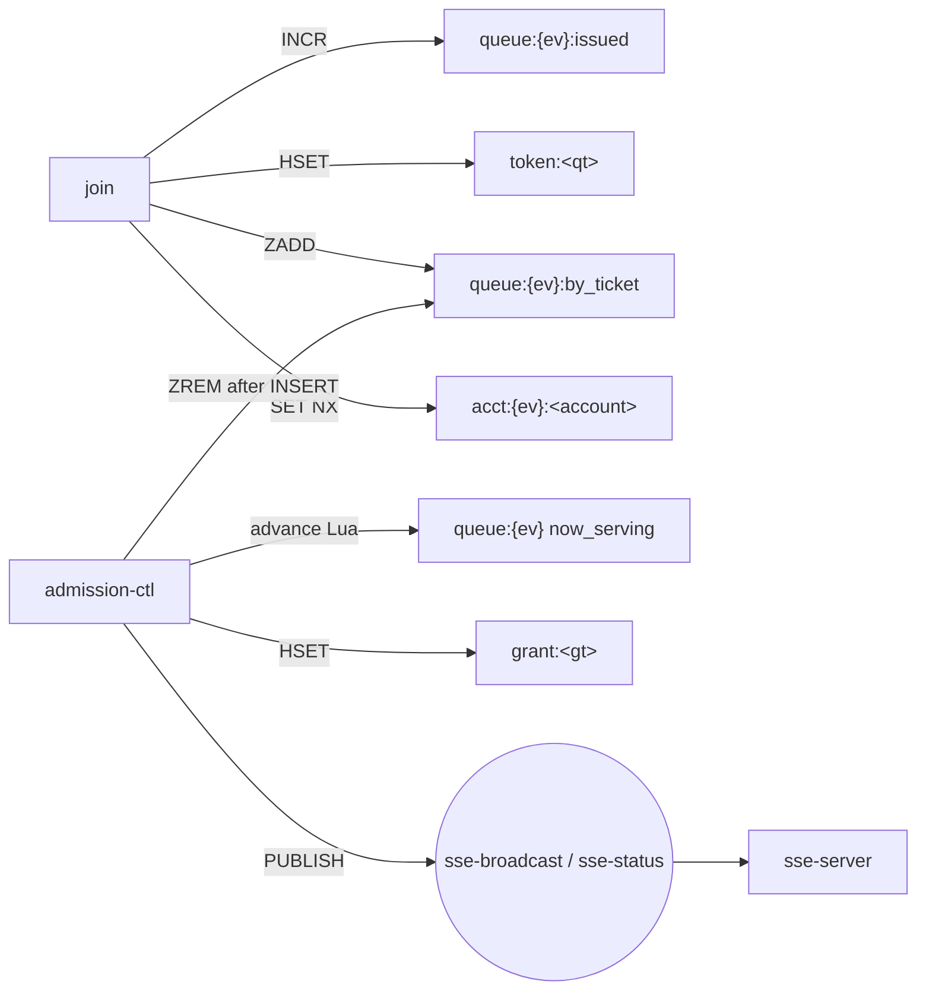

# Redis keys and channels

Every Redis key and pub/sub channel used by the backend, in one place. **The code is the
source:** queue-domain names are built only by [`pkg/rediskeys`](../pkg/rediskeys/rediskeys.go),
and a test there fails if a builder is missing from this page. Change both together.

## Rules

- **Never hand-write a key.** Add a builder to `pkg/rediskeys`, then a row here.
- **`{ev}` is the only hash tag.** Every per-event key carries `{<event_id>}`, so Redis cluster puts all of
  one event's keys in one slot and a Lua script or `WATCH`/`MULTI` may touch them together.
- **Per-customer keys have no event tag** (`token:`, `grant:`, `rl:`). Never mix them with `{ev}` keys in one
  script or transaction (cross-slot in cluster mode).
- **Never store raw personal data in a key or value.** Device ids are stored as `HMAC(DEVICE_PEPPER, id)`,
  NIKs as `nik_hmac`.
- **TTL:** every key without a natural end gets one. Keys of a live event (`queue:{ev}*`, `stock:`) do not
  expire; sale-ops cleans them up after the event.

Status: **built** = used by code on `main` or the current branch · **planned** = in the plans, no code yet.

## Queue domain (`pkg/rediskeys`)

| Key | Builder | Type | TTL | Written by | Read by | What it is | Status |
|---|---|---|---|---|---|---|---|
| `queue:{ev}` | `Event.QueueHash` | hash: `now_serving`, `rate_per_min`, `name`, `sale_starts_at` | none | sale-ops seed (`name`, `sale_starts_at`), advance Lua (`now_serving`), admission-ctl (`rate_per_min`) | all queue services | The event's counters and the two fields join echoes back (`event.name`, 409 `sale_starts_at`) | built (join reads) |
| `queue:{ev}:state` | `Event.QueueState` | string: `SCHEDULED` \| `OPEN` \| `FULL_BOOKED` \| `CLOSED` | none | sale-ops seed, opener at `sale_starts_at`, advance Lua (`FULL_BOOKED` ↔ `OPEN`), admission-ctl (`CLOSED`) | all | Sale lifecycle. Missing or unknown → join answers 503 `QUEUE_NOT_READY` | built (join reads) |
| `queue:{ev}:issued` | `Event.QueueIssued` | counter | none | join (`INCR` after every gate) | join, events (depth), admission-ctl | Last ticket number handed out. `issued − now_serving` = queue depth | built |
| `queue:{ev}:by_ticket` | `Event.ByTicket` | zset, member `queue_token`, score `ticket_no` | none | join (`ZADD`; rejoin repair `ZADD NX` only while `ticket_no > now_serving`), admission-ctl (`ZREM` last, after the GRANTED row) | advance Lua, admission-ctl RECOVER, `/me` | The line. A score ≤ `now_serving` still present = pending grant (ADR-006 rule 4) | built (join side) |
| `queue:{ev}:full_booked_at` | `Event.FullBookedAt` | string, RFC 3339 | none | advance Lua / admission-ctl when stock reaches 0 | join (409 `FULL_BOOKED` data), admission-ctl (`CLOSED` at +930 s) | When the event sold out | built (join reads) |
| `expiries:{ev}` | `Event.Expiries` | zset, member `booking_id`, score deadline | none | admission-ctl (at GRANT) | admission-ctl sweep | Deadlines to check for `GRANTED → LAPSED` and expiries | planned |
| `stock:{ev}:<category>` | `Event.Stock` | counter | none | booking `hold_booking.lua`, admission-ctl sweeps | advance Lua | Seats left per category | planned |
| `acct:{ev}:<account_id>` | `Event.Acct` | string → `queue_token` | `SALE_WINDOW_SECONDS` | join (`SET NX`; compare-and-set to replace a stale pointer) | join, `/me` | BR-07: the account's one place for this event | built |
| `token:<queue_token>` | `Token` | hash: `ticket_no`, `event_id`, `joined_at`, `account_id`?, `device_hash`? | `SALE_WINDOW_SECONDS` | join | join (rejoin), `/me`, stream, admission-ctl | The engagement. `queue_token` = `qt_` + ULID | built |
| `grant:<grant_token>` | `Grant` | hash | from the booking row's deadline | admission-ctl | `/me`, booking (`pkg/grantauth`) | A live grant (`X-Grant-Token`) | planned |
| `rl:join:<ip>` | `JoinRateLimit` | hash `{tokens, ts}` (token bucket, `pkg/ratelimit`) | refill time (300 s) | join | — | 20 joins / 5 min per IP. IP from API Gateway, never `X-Forwarded-For` | built |
| `rl:joinacct:<account_id>` | `JoinAcctLimit` | hash `{tokens, ts}` | refill time (60 s) | join | — | 3 joins / min per account | built |
| `rl:sse:<ip>` | `SSERateLimit` | token bucket | — | stream | — | Stream connect limit (5 / s) | built |

Removed by ADR-006 (a test in `pkg/rediskeys` fails if they come back): `regrant:{ev}`, `slots:open:{ev}`,
`pause:{ev}`, `pause:{ev}:grace_applied`, channel `sse-grant`.

## Channels

| Channel | Constant | Published by | Subscribed by | Payload | Status |
|---|---|---|---|---|---|
| `sse-broadcast` | `ChannelBroadcast` | admission-ctl, once per tick | sse-server (fan-out to every client) | `now_serving`, `rate_per_min`, … (api-contracts §3.2) | subscriber built |
| `sse-status` | `ChannelStatus` | admission-ctl, on each state change | sse-server (`status` event) | `{state, fullBookedAt, serverTime}` | subscriber built |

## Other services (keys still hand-written in each service)

These predate `pkg/rediskeys`. Moving them there is a follow-up; until then this table is the only list.

| Key | Service (constant) | Type | TTL | What it is |
|---|---|---|---|---|
| `ratelimit:auth:magic-link:<email>` | user (`infrastructure/redis/limiter.go`, key built in `usecase/auth.go`) | counter (fixed window) | 1 h | 5 magic-link requests per email per hour. **Note:** the raw email is in the key name |
| `nik:valid:<nik_hmac>` | nik-verify (`KeyVerifiedPrefix`) | string `"1"` | verification cache TTL | NIK already verified at Dukcapil |
| `dukcapil:breaker:state` | nik-verify (`KeyBreakerState`) | string `OPEN` | breaker open period | Dukcapil circuit breaker. The code comment says admission-ctl reads it; ADR-006 removed pause, so check before relying on that |
| `dukcapil:breaker:failures` | nik-verify (`KeyBreakerFails`) | counter | breaker open period | Consecutive Dukcapil failures |
| `dukcapil:ratelimit` | nik-verify (`KeyRateLimit`) | token bucket | refill time | Global ceiling on Dukcapil calls |
| `processed:<outbox_id>` | outbox-publisher (`KeyProcessedPrefix`); payment-api will share it | string: worker id, then `done` | `OUTBOX_LEASE_SECONDS`, then `OUTBOX_LEASE_DONE_SECONDS` | Lease on an outbox row |
| `email:sent:<outbox_id>` | notification (`KeySentPrefix`) | string `"1"` (`SET NX`) | dedupe TTL | An email for this outbox row has gone out |
