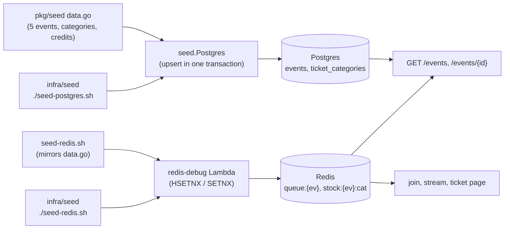

# Seed data — Jakarta events

| | |
|---|---|
| **What** | Sample events in Jakarta for local and dev: Postgres catalog + Redis sale state + stock, with real, free-licence photos |
| **Not an endpoint** | Feeds `GET /events`, `GET /events/{id}`, `GET /events/{id}/tickets`, join and the stream, so the home page, the queue and booking can be tried end to end |
| **Status** | approved 2026-11-11, built in `pkg/seed` (Postgres library) + `infra/redis-debug` (Redis seeding via Lambda) |

## 1. In simple terms

Today the database is empty, so the home page has nothing to show and the queue has nothing to queue for.
This seed puts five events in the catalog, each in a **different sale state**, so every card and every error path
can be seen without hand-typing Redis commands.

Example: after seeding, the home page lists "Nightfall Live di Istora" (button on), "Garuda Stadium Fest" (not open
yet), "Malam Wayang Kontemporer" (every seat held), "Ancol Sunset Sessions" (button on) and an expo that already closed.

**Note:** Postgres and Redis seeding are split because Redis (ElastiCache) is not accessible from outside the VPC.

## 2. Decisions already made (Erma)

| Question | Answer |
|---|---|
| Real or made-up events | **Fictional** events at **real Jakarta venues** (no real artists or trademarks) |
| Pictures | **Hotlinked free-licence URLs** (Wikimedia Commons), nothing stored in git |
| Where it lives | **Idempotent seed script + `make seed`**, not a numbered migration (so it never ships to prod) |

## 3. What gets seeded



### Architecture

Both Lambdas are deployed together in `infra/seed`:

| Script | Seeds | Lambda |
|---|---|---|
| `./seed-postgres.sh` | Postgres (events, ticket_categories) | `rusuh-{env}-seed` |
| `./seed-redis.sh` | Redis (queue state, stock) | `rusuh-{env}-redis-debug` |

Both run inside the VPC via Lambda, so they can reach Aurora and ElastiCache.

### 3.1 Events

Dates are Asia/Jakarta (WIB, UTC+7); `sale_starts_at` is stored in UTC.

| id | Name | Category | Venue | Event date / time | `queue:{ev}.state` | Why this state |
|---|---|---|---|---|---|---|
| `evt_jkt_istora_nightfall` | Nightfall Live di Istora | LIVE MUSIC | Istora Gelora Bung Karno, Senayan | 2026-12-19 19:30 | `OPEN` | the normal "queue is open" card |
| `evt_jkt_gbk_garuda_fest` | Garuda Stadium Fest | LIVE MUSIC | Stadion Utama Gelora Bung Karno | 2027-01-30 18:00 | `SCHEDULED` (`sale_starts_at` 2026-12-01 10:00 WIB) | "not open yet", 409 `SALE_NOT_OPEN` |
| `evt_jkt_tim_wayang` | Malam Wayang Kontemporer | THEATER | Teater Besar, Taman Ismail Marzuki | 2026-12-05 19:00 | `FULL_BOOKED` (`full_booked_at` set, all stock 0) | every seat held, still joinable |
| `evt_jkt_ancol_sunset` | Ancol Sunset Sessions | FESTIVAL | Pantai Festival, Ancol | 2026-11-28 16:00 | `OPEN` | a second open card, cheaper tiers |
| `evt_jkt_jcc_creator_expo` | Jakarta Creator Expo | EXPO | Jakarta Convention Center, Senayan | 2026-10-24 10:00 | `CLOSED` | sold out and over, 410 `SALE_CLOSED` |

`location_city` is `Jakarta` for all. Descriptions are 2–3 sentences of plain Indonesian, clearly generic.

### 3.2 Ticket categories and stock

Capacity is realistic for the venue but small enough to exhaust by hand. Prices are IDR. `max_per_order` is 3 (the project
default). `sort_order` lists the most expensive first, as the page does.

| Event | Category (id → price / capacity) |
|---|---|
| Nightfall Live | `VIP` 1.500.000 / 300 · `FESTIVAL` 750.000 / 3000 · `TRIBUNE` 450.000 / 3000 |
| Garuda Stadium Fest | `VIP` 2.500.000 / 1000 · `CAT1` 1.250.000 / 8000 · `CAT2` 650.000 / 20000 |
| Malam Wayang | `VIP` 900.000 / 100 · `REGULER` 350.000 / 900 (both `available` 0) |
| Ancol Sunset | `FESTIVAL` 275.000 / 2500 · `VIP` 600.000 / 200 |
| Creator Expo | `ONE_DAY` 125.000 / 5000 (`available` 0) |

### 3.3 Redis

Per event, **only if the key is missing** (`HSETNX` / `SETNX`), so a second `make seed` can never reset `issued` (reissued
numbers would collide with `by_ticket`; `docs/redis-keys.md`):

| Key | Fields / value |
|---|---|
| `queue:{ev}` | `state`, `issued` = 0, `now_serving` = 0, `name`, `sale_starts_at` (ISO 8601 UTC); `full_booked_at` (epoch s) for the FULL_BOOKED event only |
| `stock:{ev}:<category>` | the category's `available` (0 for sold-out categories) |

Field and key names come from `pkg/rediskeys`, never hand-typed. `full_booked_at` is stamped with the seed time, not a fixed
date: admission-ctl closes a FULL_BOOKED sale 930 s after it, so a fixed past date would close the demo event at once.

### 3.4 Pictures

One hotlink per event, a 1280 px Wikimedia Commons thumbnail (`image_url`). Each was fetched (HTTP 200, `image/jpeg`) and
looked at on 2026-11-11. They are **photos of the venues**, not of the fictional events, so nothing claims a real show
took place.

| Event | Commons file | Author | Licence |
|---|---|---|---|
| Nightfall Live | `Istora Gelora Bung Karno, 3 March 2024.jpg` | RasyaAbhirama13 | CC BY-SA 4.0 |
| Garuda Stadium Fest | `GBK Main Stadium during Athletics APG2018 (5).jpg` | Emille Ilmansyah | CC BY-SA 2.0 |
| Malam Wayang | `Tampak Depan Teater Besar Taman Ismail Marzuki (Januari 2025).jpg` | Medelam | CC BY-SA 4.0 |
| Ancol Sunset | `Ancol Beach Jakarta Sunset RT.jpg` | Rantemario | CC BY-SA 4.0 |
| Creator Expo | `Jakarta Convention Center (2024).jpg` | Medelam | CC BY-SA 4.0 |

Rejected after viewing: Ancol boats (not a festival), JIS bus stop (poor), GBK match photo (real players and sponsor/AFC
branding on a fictional event).

## 4. Rules

1. **Idempotent.** Running `make seed` twice changes nothing the second time.
2. **Postgres upsert by `id`.** `events` rows are updated in place (a fixed image or description re-applies);
   `ticket_categories` update name, price, capacity and sort order but **never `available`** (that is a live snapshot).
3. **Redis is create-only.** No overwrite, no delete. State and stock of a running sale are never touched. The one
   exception is `make seed-reset`, which deletes only the five sample events' keys first (tickets issued for them are lost).
4. **Local and dev only.** Not a migration, not run by the pipeline, and the command refuses a `REDIS_ADDR` / `DATABASE_URL`
   whose host is not localhost / 127.0.0.1 / ::1 unless `SEED_ALLOW_REMOTE=1`.
5. **No secrets in the seed.** The DB password comes from `.env` (`POSTGRES_PASSWORD`), like `make deps-up`.
6. **Future dates.** Open and scheduled events are dated after 2026-11-11; the closed expo is the only past one.

## 5. Decisions on the OPEN items (all taken as proposed)

1. Credits live in the Go data (`ImageCredit`) and §3.4; frontend shows them (no API field, no Apidog change).
2. Hotlinks accepted for local/dev; copy to our own bucket before a real launch.
3. `make seed-reset` added, local guard applies.
4. Go (`pkg/seed`, not `tools/`: it is in the `pkg` module so CI tests and the coverage gate already cover it).
5. FULL_BOOKED event seeded with stock 0, as in §3.2.

Category ids are `cat_<event>_<tier>` because `ticket_categories.id` is the primary key (a plain `VIP` would collide).

### Original open items (kept for the record)

- **OPEN 1: attribution.** CC BY-SA needs a credit next to the image. Proposal: keep the credit in the seed SQL comments
  and in §3.4 now; ask the frontend team to show "Foto: <author> / Wikimedia Commons, CC BY-SA" on the detail page (the API
  has no field for it, and adding one means an Apidog change in the shared repo, so ask first).
- **OPEN 2: link rot and hotlink limits.** Wikimedia allows reuse but may throttle heavy hotlinking, and files can be renamed.
  Proposal: accept it for local/dev; before a real launch copy the five images to our own bucket and update `image_url`.
- **OPEN 3: reset.** Create-only Redis means changing a seeded state needs a manual delete. Proposal: a `make seed-reset`
  that deletes only the five seeded events' keys, local stack only (rule 4 guard), never wired into `verify`.
- **OPEN 4: how the script gets Redis field names.** Proposal: a tiny Go program `tools/seed` (uses `pkg/rediskeys`, the
  repo's own Postgres and Redis clients, reads the same event table as data) instead of shell `redis-cli`, so a renamed
  field breaks the build, not the seed. Shell + SQL is simpler; Go is safer. Recommendation: **Go**.
- **OPEN 5: ticket categories for `FULL_BOOKED`.** Proposal as in §3.2 (stock 0, state `FULL_BOOKED`). Say if you would
  rather have the seat counts non-zero and let a demo drive them to 0.

## 6. Checklist

- [x] Plan approved (this file)
- [x] Data: five events and 11 categories with image credits (`pkg/seed/data.go`)
- [x] `seed.Postgres` (upsert, `available` never rewritten), `seed.Redis` (create-only), `seed.ResetRedis`, `seed.CheckLocal`
- [x] `make seed` / `make seed-reset`, password from `.env`
- [x] Tests: data is complete and unique; Redis create-only and a re-seed leaves `issued`, `now_serving`, state and stock
      alone; reset touches only the sample events; guard cases; Postgres SQL on a fake (CI) and on real Postgres (`pgtest`)
- [x] Run end to end: `make seed` into a fresh migrated database + the real Redis cluster, second run created 0,
      `GET /events` from the real events service returned all five with the right `queue_state`
- [ ] `make verify`, then stop for review

## 7. How to run

### AWS Environment (prod/dev)

```bash
cd infra/seed

# 1. Deploy the seed stack (both Lambdas)
./deploy.sh

# 2. Seed Postgres
./seed-postgres.sh

# 3. Seed Redis
./seed-redis.sh
./seed-redis.sh --reset  # optional: clear keys first

# 4. Verify
./redis.sh DBSIZE        # should show 17 keys
./redis.sh KEYS '*'      # list all keys
./redis.sh HGETALL 'queue:{evt_jkt_istora_nightfall}'

# 5. Cleanup when done
./destroy.sh
```

### Local Development

For local development with Docker:

```bash
cp -n .env.example .env     # set POSTGRES_PASSWORD
make deps-up                # start Postgres + Redis in Docker

# Apply migrations first (see migrations/README.md)

# Seed Postgres (local)
DATABASE_URL="postgres://..." go run ./pkg/seed/cmd/seed

# Seed Redis manually
docker exec -it redis redis-cli
> HSET queue:{evt_jkt_istora_nightfall} state OPEN issued 0 now_serving 0 name "Nightfall Live"
> SET stock:{evt_jkt_istora_nightfall}:cat_istora_vip 300
```

### Useful Commands

```bash
cd infra/seed

# Check event states
./redis.sh HGET 'queue:{evt_jkt_istora_nightfall}' state  # OPEN
./redis.sh HGET 'queue:{evt_jkt_gbk_garuda_fest}' state   # SCHEDULED
./redis.sh HGET 'queue:{evt_jkt_tim_wayang}' state        # FULL_BOOKED

# Change an event's state
./redis.sh HSET 'queue:{evt_jkt_gbk_garuda_fest}' state OPEN

# Check/update stock
./redis.sh GET 'stock:{evt_jkt_istora_nightfall}:cat_istora_vip'  # 300
./redis.sh SET 'stock:{evt_jkt_istora_nightfall}:cat_istora_vip' 100
```
